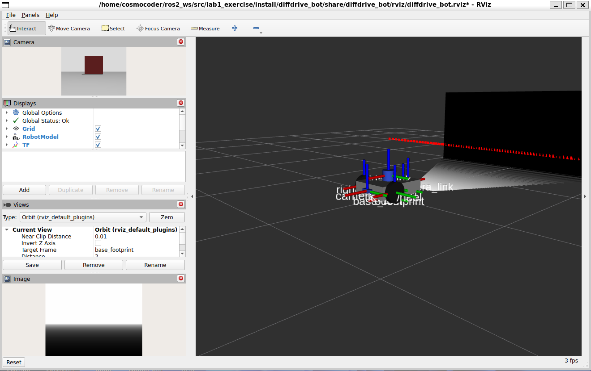
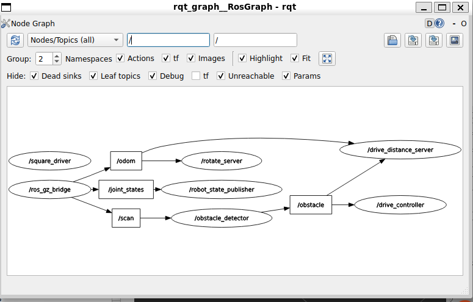

# Lab 1 Exercise

## Build

From the workspace root:

```bash
rm -rf build install log
colcon build --symlink-install
source install/setup.bash
```

## Run

Step 1, display the robot and verify the sensor frames:

```bash
ros2 launch diffdrive_bot display.launch.py
```

Start the simulation for Steps 2–6:

```bash
ros2 launch diffdrive_bot control.launch.py
ros2 run my_robot_nodes turn_away
```

Enable the obstacle controller:

```bash
ros2 service call /turn_away_enable std_srvs/srv/SetBool "{data: true}"
```

Set the turn speed:

```bash
ros2 service call /set_turn_speed my_robot_interfaces/srv/SetTurnSpeed "{turn_speed: 1.0}"
```

Test the rotate action:

```bash
ros2 action send_goal --feedback /rotate my_robot_interfaces/action/Rotate "{angle: 1.57}"
```

Step 7 starts the simulation, rotate server, and square driver:

```bash
ros2 launch my_robot_nodes square.launch.py side_length:=0.8
```

The depth image and point cloud are available on `/depth_camera/image` and
`/depth_camera/points`. The IMU is available on `/imu`.

## Screenshots

### RViz depth image and point cloud



### rqt_graph while running the square driver



## What did not work

Initially, `/depth_camera/image`, `/depth_camera/points`, and `/imu` were not
available. The original lab packages and the completed copies had the same
package names, so the workspace installed the original package configuration
instead of the completed `lab1_exercise` configuration. This was fixed by
ignoring the original `lab_01` packages and rebuilding the workspace from a
clean `build`, `install`, and `log` directory.

The square driver initially did not move the robot because `rotate_server`
failed to start. Its ROS 2 `ActionServer` constructor used the goal callback as
a positional argument, which is not supported by the installed ROS 2 version.
The callback was changed to a keyword argument, after which the rotate action
server started correctly and the square driver could continue.
